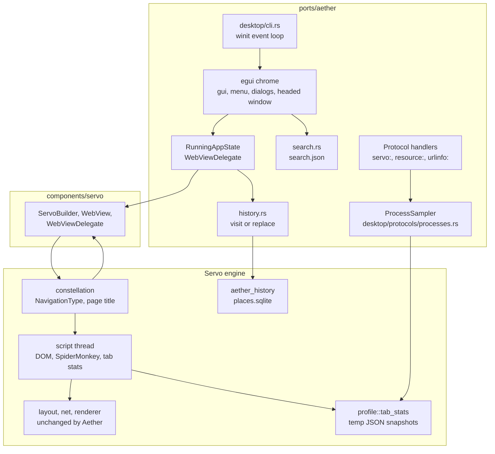
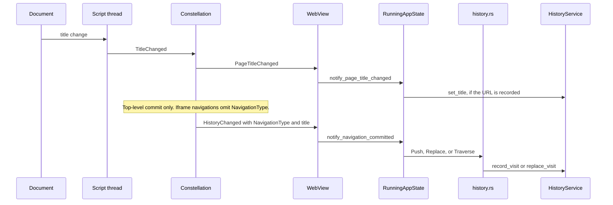
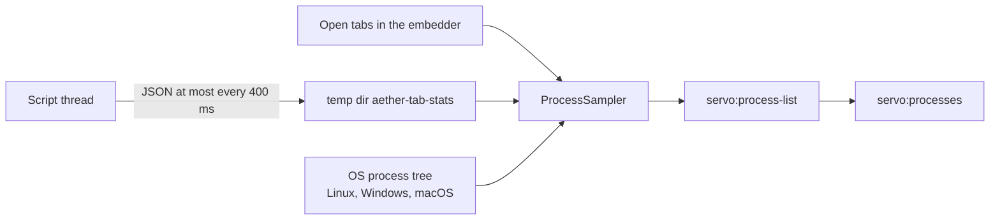

# Architecture

Aether is the browser. Servo is the engine it embeds.
This page first describes `ports/aether` and the Servo components Aether changes, then the engine architecture Aether inherits.

## The Aether port

`ports/aether` is the embedder. On the desktop it owns the winit event loop, the egui chrome, and the profile.
Android and OpenHarmony use the same crate through `ports/aether/egl`, but their packages still load `aether.so`.



Solid arrows are calls or messages. The chrome never talks to script threads directly. It goes through `WebView` and the constellation, which is the same boundary Servo gives every embedder.

`desktop/app.rs` builds that boundary at startup:

1. Load search engines from `{config_dir}/search.json`.
2. Register the `urlinfo`, `servo`, and `resource` protocol handlers.
3. Build a `Servo` with `ServoBuilder` and open a `HistoryService` on `places.sqlite`.
4. Open a window whose `RunningAppState` is the `WebViewDelegate`.

The application menu (`desktop/menu.rs`) is New Tab, New Window, History, Settings, More Tools, and Exit. More Tools opens the developer-tools dock and `servo:processes`.

| Page | What serves it |
| --- | --- |
| `servo:newtab`, `servo:history`, `servo:settings`, `servo:processes`, `servo:preferences`, `servo:config`, `servo:license` | `ServoProtocolHandler` reads HTML from `resources/resource_protocol` through `resource:` |
| `servo:search-engines` | JSON read and write of `search.json`. The location bar substitutes `%s` in the engine URL |
| `servo:process-list` | JSON snapshot from `ProcessSampler`. Requests whose origin or referrer is a web scheme are rejected |
| `urlinfo:` | Echoes the requested URL |

Built-in search engines are DuckDuckGo, Google, Bing, and Startpage. DuckDuckGo is the default. The settings page edits this list at `servo:settings#search`.

The developer-tools entry opens an egui dock on the right of the window (`gui.rs`). It is chrome around the page, separate from Servo's remote DevTools server.

## Class diagram

[`class_diagram.xmi`](class_diagram.xmi) is a UML model of the Aether shell (`ports/aether`) and of the Servo components this repository changes: `aether_history`, the constellation, embedder traits, script, and profile. Packages follow the Rust modules. Traits are interfaces. Enums are enumerations. A module that only holds free functions is a utility class. Composition means ownership. Shared aggregation means an `Rc` or a shared reference. Types Aether only extends, such as `WebView` and `WebViewDelegate`, stay in the `external` package.

<div class="class-diagram" data-xmi="class_diagram.xmi">
<form class="class-diagram-toolbar" id="class-diagram-controls">
<label>Package <select id="class-diagram-package" name="package"></select></label>
<label class="check"><input type="checkbox" id="class-diagram-neighbors"> Linked neighbors</label>
<label class="check"><input type="checkbox" id="class-diagram-members"> Attributes and operations</label>
<label class="check"><input type="checkbox" id="class-diagram-deps" checked> Dependencies</label>
<label class="check"><input type="checkbox" id="class-diagram-external"> External types</label>
<label class="check"><input type="checkbox" id="class-diagram-rust-types"> Generated Rust types</label>
<button type="submit" id="class-diagram-draw">Draw</button>
<button type="button" id="class-diagram-zoom-out" title="Zoom out">−</button>
<button type="button" id="class-diagram-zoom-in" title="Zoom in">+</button>
</form>
<p class="class-diagram-status">Reading the model…</p>
<div class="class-diagram-stage" tabindex="0">
<div class="class-diagram-canvas"></div>
</div>
</div>

## History

Aether stores a profile history, distinct from the session history Servo already keeps for back and forward. Only top-level `http` and `https` documents are recorded. `servo:`, `about:`, `data:`, `blob:`, and `file:` URLs are not. Usernames and passwords are stripped before the row is written.



`NavigationType` lives in `components/shared/embedder` and is set on the session-history change inside the constellation:

- **Push** adds an entry, for example a link click or `history.pushState()`.
- **Replace** overwrites the active entry. That covers meta refresh, `location.replace()`, a script navigation before the load finishes, `history.replaceState()`, and reload.
- **Traverse** activates an existing entry, for example back or forward. Aether does not count it as a new visit.

`history.rs` then decides what to persist:

- The same URL as the active entry changes nothing.
- **Replace** moves the existing visit onto the new URL, which is how a client-side redirect keeps a single visit.
- **Push**, and a **Replace** that has no visit to move, inserts a visit dated at commit time.
- **Traverse** updates the active entry and writes nothing.

`components/aether_history` applies those commands on a thread named `History`, in batches, against a SQLite database shaped like Firefox `places.sqlite`: one `places` row per URL, one `visits` row per visit, plus the last title. Dropping the service drains the queue. If the database cannot be opened, browsing continues with history disabled for that session. Temporary profiles and runs without a config directory keep the database in memory.

Titles no longer travel as `EmbedderMsg::ChangePageTitle` straight from the document. The document sends `TitleChanged` to the constellation, and the constellation forwards `PageTitleChanged` only when the pipeline is the active top-level document. `WebView::set_history` also carries the title known at commit time, and reports `notify_page_title_changed` when it differs.

`components/script/dom/window/location.rs` now checks transient activation before forcing `historyHandling` to replace. A navigation started with transient activation, on a document that has not finished loading, can push instead of replace.

## Process list

`servo:processes` needs data the embedder cannot see from `WebView` alone: per-process CPU and memory, and the SpiderMonkey heap of each script thread.



`components/shared/profile/tab_stats.rs` is the cross-process side of that pipe. Each script thread publishes a `ScriptTabStats` snapshot (pid, tid, webview id, top-level URL, `JSGC_BYTES`) and removes it when the thread stops. Files older than 10 seconds are stale. The sampler reads them, walks the browser's descendant processes, and returns one JSON document to the page. Web content cannot fetch `servo:process-list`.

## The Servo engine

Servo is a project to develop a new web browser engine.
Our goal is to create an architecture that takes advantage of parallelism at many levels while eliminating common sources of bugs and security vulnerabilities associated with incorrect memory management and data races.

Because C++ is poorly suited to preventing these problems, Servo is written in [Rust](http://rust-lang.org), a modern language designed specifically with Servo's requirements in mind.
Rust provides a task-parallel infrastructure and a strong type system that enforces memory safety and data race freedom.

```mermaid
flowchart TB
    subgraph Web Content Process
    ScriptA[Script Thread]-->PipelineA[Pipeline A]
    PipelineA
    PipelineA-->ImageA[Image Cache]
    PipelineA-->FontA[Font Cache]
    PipelineA-->LayoutA[Layout]
    LayoutA-->ImageA
    LayoutA-->FontA

    ScriptA[Script Thread]-->PipelineB[Pipeline B]
    PipelineB
    PipelineB-->ImageB[Image Cache]
    PipelineB-->FontB[Font Cache]
    PipelineB-->LayoutB[Layout]
    LayoutB-->ImageB
    LayoutB-->FontB
    end

    subgraph Embedder Process
    direction TB
    Embedder-->Constellation[Constellation Thread]
    Embedder<-->Renderer[Renderer]
    Constellation<-->Renderer
    Renderer-->WebRender
    Constellation-->SystemFont[System Font Cache]
    Constellation-->Resource[Resource Manager]
    end

    Constellation<-->ScriptA
    FontA-->SystemFont
    PipelineA-->Renderer
    FontB-->SystemFont
    PipelineB-->Renderer
 ```

This diagram shows the architecture of multiprocess Servo running with a single web content process.
When multiprocess mode is enabled, each script thread runs in its own web content process.
When multiprocess mode is disabled, all script threads run in the embedder process.
Each script thread has a set of communication channels with the constellation and embedding API parts of the embedder process.
Solid lines indicate communication channels or API calls.

## Constellation, script threads, and pipelines

Each Servo instance has a single [constellation](https://github.com/servo/servo/blob/main/components/constellation/lib.rs), which manages the web content processes for all frames in all `WebView`s.
The script thread in the web content process manages multiple pipelines, one for each `<iframe>` or main frame in the `WebView`.
The pipeline in the script thread is responsible for accepting input, running JavaScript against the DOM, performing layout, building display lists, and sending display lists to the renderer.
There is a single renderer for the entire Servo instance, which manages multiple WebRender instances which render to a variety of `RenderingContext`s (essentially OpenGL contexts on platform surfaces).

The pipeline consists of three main parts:

* **[Script](script.md)**: Script's primary mission is to create and own the DOM and execute the JavaScript engine.
  It receives events from multiple sources, including navigation events, and routes them as necessary.
* **[Layout](layout.md)**: Layout initially starts in the same thread as Script, but may use worker threads to lay out a page in parallel. It calculates styles, and constructs the two main layout data structures, the *[box tree](layout.md#box-tree)* and the *[fragment tree](layout.md#fragment-tree)*.
  The fragment tree is used to determine untransformed positions of nodes and from there to build a display list, which is sent to the renderer.
* **[Renderer](compositor.md)**: The renderer (also known as the compositor) forwards display lists to [WebRender](https://github.com/servo/webrender), which is the content rasterization and display engine used by both Servo and Firefox.
  It uses the GPU to render the final image of the page.
  Running on the embedder's user interface thread, the renderer is also the first to receive input events, which are generally immediately sent to the constellation and then the script thread for processing.
  Some events, such as scroll and touch events, can be handled initially by the renderer for responsiveness.

## Concurrency and parallelism

Concurrency is the separation of tasks to provide interleaved execution.
Parallelism is the simultaneous execution of multiple pieces of work in order to increase speed.
Here are some ways that we take advantage of both:

* **Task-based architecture**:
  Major components in the system should be factored into actors with isolated heaps, with clear boundaries for failure and recovery.
  This will also encourage loose coupling throughout the system, enabling us to replace components for the purposes of experimentation and research.
* **Concurrent rendering**:
  Rendering is a separate thread, decoupled from layout in order to maintain responsiveness.
  The renderer thread manages its memory manually to avoid garbage collection pauses.
* **Selector matching**:
  This is an embarrassingly parallel problem.
  Like Gecko, Servo does selector matching in a separate pass from flow tree construction so that it is more easily parallelized.
* **Parallel layout**:
  We build the flow tree using a parallel traversal of the DOM that respects the sequential dependencies generated by elements such as floats.
* **Parsing**:
  We have written a new HTML parser in Rust, focused on both safety and compliance with the specification.
  We have not yet added speculation or parallelism to the parsing.
* **Image decoding**:
  Decoding multiple images in parallel is straightforward.
* **Decoding of other resources**:
  This is probably less important than image decoding, but anything that needs to be loaded by a page can be done in parallel, e.g. parsing entire style sheets or decoding videos.
  Style sheets are parsed in parallel when possible.

## Challenges

* **Parallel-hostile libraries**:
  Some third-party libraries we need don't play well in multithreaded environments.
  Fonts in particular have been difficult.
  Even if libraries are technically thread-safe, often thread safety is achieved through a library-wide mutex lock, harming our opportunities for parallelism.
* **Too many threads**:
  If we throw maximum parallelism and concurrency at everything, we will end up overwhelming the system with too many threads.
* **Too many open file handles**:
  IPC communication usually requires opening a file handle on the system.
  We have run into issues ([#23910](https://github.com/servo/servo/issues/23910), [#33672](https://github.com/servo/servo/issues/33672), [#23905](https://github.com/servo/servo/issues/23906)) with file handle exhaustion due to overuse of IPC mechanisms.

## JavaScript and DOM bindings

We are currently using SpiderMonkey, although pluggable engines is a long-term, low-priority goal.
Each web content process gets its own JavaScript runtime.
DOM bindings use the native JavaScript engine API instead of XPCOM, automatically generated via WebIDL.

## Multi-process architecture

Similar to Chromium and WebKit2, we intend to have a trusted embedder process and multiple, less trusted web content processes.
The high-level API is IPC-based, with non-IPC implementations for testing and single-process use-cases, though it is expected most serious uses would use multiple processes.
The engine processes will use the operating system sandboxing facilities to restrict access to system resources.

Rust's type system also adds a significant layer of defense against memory safety vulnerabilities.
This alone does not make a sandbox any less important to defend against unsafe code, bugs in the type system, and third-party/host libraries, but it does reduce the attack surface of Servo significantly relative to other browser engines.
Additionally, we have performance-related concerns regarding some sandboxing techniques (for example, proxying all OpenGL calls to a separate process).

## I/O and resource management

Web pages depend on a wide variety of external resources, with many mechanisms of retrieval and decoding.
These resources are cached at multiple levels—on disk, in memory, and/or in decoded form.
In a parallel browser setting, these resources must be distributed among concurrent workers.

Traditionally, browsers have been single-threaded, performing I/O on the "main thread", where most computation also happens.
This leads to latency problems.
In Servo there is no "main thread" and the loading of all external resources is handled by a single [resource manager] task.

[resource manager]: https://github.com/servo/servo/blob/main/components/net/resource_thread.rs

Browsers have many caches, and Servo's task-based architecture means that it will probably have more than extant browser engines (e.g. we might have both a global task-based cache and a task-local cache that stores results from the global cache to save the round trip through the scheduler).
Servo should have a unified caching story, with tunable caches that work well in low-memory environments.

## References

Important research and accumulated knowledge about browser implementation, parallel layout, etc.:

* [How Browsers Work](http://ehsan.github.io/how-browsers-work/#1) - basic explanation of the common design of modern web browsers by long-time Gecko engineer Ehsan Akhgari
* [More how browsers work](http://taligarsiel.com/Projects/howbrowserswork1.htm) article that is dated, but has many more details
* [Webkit overview](https://web.archive.org/web/20150804185551/https://www.webkit.org/coding/technical-articles.html)
* [Fast and parallel web page layout (2010)](https://lmeyerov.github.io/projects/pbrowser/pubfiles/paper.pdf) - Leo Meyerovich's influential parallel selectors, layout, and fonts.
  It advocates separating parallel selectors from parallel cascade to improve memory usage.
  See also the [2013 paper for automating layout](https://lmeyerov.github.io/projects/pbrowser/pubfiles/synthesizer2012.pdf) and the [2009 paper that touches on speculative lexing/parsing](http://lmeyerov.github.io/projects/pbrowser/hotpar09/paper.pdf).
* [Servo layout on mozilla wiki](https://wiki.mozilla.org/Servo/StyleUpdateOnDOMChange)
* [Robert O'Callahan's mega-presentation](http://robert.ocallahan.org/2012/04/korea.html) - Lots of information about browsers
* [ZOOMM paper](https://www.researchgate.net/publication/277679324_ZOOMM) - Qualcomm's network prefetching and combined selectors/cascade
* [Strings in Blink](https://chromium.googlesource.com/chromium/src/+/HEAD/third_party/blink/renderer/platform/wtf/text/README.md)
* [Incoherencies in Web Access Control Policies](http://research.microsoft.com/en-us/um/people/helenw/papers/incoherencyAndWebAnalyzer.pdf) - Analysis of the prevelance of document.domain, cross-origin iframes and other weirdness
* [A Case for Parallelizing Web Pages](https://www.usenix.org/system/files/conference/hotpar12/hotpar12-final58.pdf) -- Sam King's server proxy for partitioning webpages.
  See also his [process-isolation work that reports parallelism benefits](https://cseweb.ucsd.edu/~dstefan/cse291-spring21/papers/grier:op.pdf).
* [High-Performance and Energy-Efficient Mobile Web Browsing on Big/Little Systems](https://edge.seas.harvard.edu/sites/g/files/omnuum6351/files/zhu10hpca_0.pdf) Save power by dynamically switching which core to use based on automatic workload heuristic
* [C3: An Experimental, Extensible, Reconfigurable Platform for HTML-based Applications](https://web.archive.org/web/20140718031023/http://research.microsoft.com/apps/pubs/default.aspx?id=150010) Browser prototype written in C# at Microsoft Research that provided a concurrent (though not successfully parallelized) architecture
* [CSS Inline vertical alignment and line wrapping around floats](https://github.com/dbaron/inlines-and-floats) - dbaron imparts wisdom about floats
* [Quark](http://goto.ucsd.edu/quark/) - Formally verified browser kernel
* [HPar: A Practical Parallel Parser for HTML](https://web.archive.org/web/20150823220338/https://www.cs.ucr.edu/~zhijia/papers/taco13.pdf)
* [Gecko HTML parser threading](https://web.archive.org/web/20171209054744/https://developer.mozilla.org/en-US/docs/Mozilla/Gecko/HTML_parser_threading)
